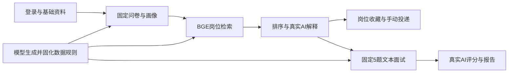
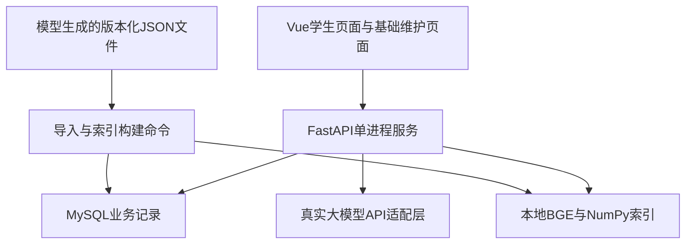
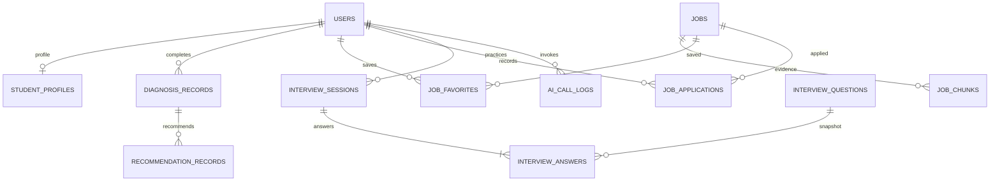

# TRACE大学生就业赋能平台需求分析与开发文档

版本 2.0　修订日期 2026年10月5日　适用阶段 一期实施与二期规划

仓库公开版：分工使用职责名称，不包含项目成员和指导老师的真实姓名；需求、算法规则、接口、数据库及开发计划与原设计一致。署名原稿及 Word 阅读版仅保留本机。

一期交付面向学生的可运行原型：完成职业诊断、查看能力画像、通过基础RAG获取岗位推荐和真实大模型解释、进行文本模拟面试、查看评分报告，并使用岗位收藏和手动投递记录。当前没有业务数据，先由模型生成并固化开发所需的岗位、题库、问卷、规则和测试样例，再据此实现功能。

ARIMA就业趋势预测、分级帮扶与辅导员闭环统一安排在二期。一期验收不依赖这些模块，也不依赖真实招聘数据或学生名册，但必须完成真实大模型API联调。演示数据用于验证程序；后续按申报书补充真实数据、算法评估和业务试点。

本版同步调整需求、数据库、接口、页面、规则、排期与验收。配套SQL是一期建表设计基线，配置文件是待实现应用的设置清单，样例数据目录提供可使用的初始内容；这些产物不代表应用代码已经完成。

## 1 分期范围与本次修订

### 1.1 项目依据

正式项目名称为“融合RAG与时序预测的大学生就业赋能平台”，研究期为2026年6月至2027年5月。申报书提出岗位推荐、趋势预测、模拟面试、职业诊断和分级帮扶。本版按项目组意见调整实施顺序，保留申报书作为完整项目的最终方向。

申报预算为1000元，其中大模型调用300元、服务器和存储600元、资料与打印100元。具体服务商、模型和价格在接入时确定。开发中先通过生成数据验证功能，再逐步完善复杂能力，不将首期原型等同于全部结题成果。

### 1.2 已确认的开发决定

| 事项 | 一期安排 | 后续安排 |
| --- | --- | --- |
| 岗位推荐 | 保留本地BGE检索、证据片段与真实大模型解释 | 增强重排、评估、数据量和自动更新 |
| 模型调用 | 接入真实大模型API，支持明确的失败降级 | 增加服务商、成本优化和评分校准 |
| 职业诊断 | 固定10题、规则计算四维画像 | 扩展到申报书15至20题及更细画像 |
| 模拟面试 | 固定5道主问题、文本答题、一次整场评分 | 增加规则追问、最多2层、可选二次评分 |
| 收藏与投递 | 收藏/取消收藏、手动记录投递及更新状态 | 接入行为统计和辅导员业务 |
| ARIMA预测 | 不实现，不创建相关页面、接口和表 | 二期开发历史序列、回测和预测 |
| 分级帮扶与辅导员闭环 | 不实现，不创建相关页面、接口和表 | 二期开发规则、核验、案件、跟进和看板 |
| 数据准备 | 模型生成并固化演示数据、初始规则和测试样例 | 引入真实来源，人工校准与正式评估 |

不限定数据库表数量。独立查询、有生命周期或有多条记录的对象保留独立表；固定问卷、分类字典、评分权重用版本化JSON配置；小规模报告保存为JSON。当前方案按这些业务边界形成12张表，后续需求改变时允许正常增减，避免为了控制数量把全部业务塞入一张表。

### 1.3 一期暂不做的复杂能力

一期暂不做多学校组织树、辅导员分管范围、就业状态核验、就业率统计、站内通知、批量报表导出、自动招聘采集、动态追问、模型微调、分布式任务队列及通用规则发布平台。管理员只需维护岗位和题库；大批量导入和向量索引构建先用本地命令完成。

一期使用单校、少量账号、单API进程的小规模部署。简化的是部署规模和工作流，账号权限、回答保存、结果校验、数据标识及失败提示仍需实现。

## 2 用户角色与权限

一期角色仅有学生和管理员。学生访问自己的诊断、推荐、面试、收藏和投递记录；管理员维护公共岗位和题库、检查导入结果，不默认开放学生的完整答题内容。辅导员角色二期再增加。

学生注册使用用户名和密码，不要求真实学号、手机号或学院名册。数据库保存密码哈希；演示账号密码由初始化命令在本地生成，不写入样例数据和源码。学生注册接口忽略或拒绝客户端提交的role，只能创建student。

登录后使用带过期时间的HttpOnly Cookie保存签名令牌，默认有效期2小时，不做自动续期。users.token_version随退出登录、改密或管理员停用而递增；鉴权时同时校验令牌版本，因此退出会使该用户现存令牌失效。写接口校验Origin，生产开启HTTPS、Secure和SameSite Cookie。开发跨域只允许配置的前端来源。

所有个人资源先检查user_id归属；客户端不得指定另一个学生作为资源所有者。公共ID使用字符串传输，避免前端大整数精度问题。角色由后端判断，前端隐藏菜单仅用于界面展示。

## 3 一期需求清单与验收目标

I表示一期需求，II表示二期需求。编号取代上一版FR优先级表，避免把二期功能继续当作一期必做项。下列验收条件是开发目标，测试完成后另记录实测结果。

| 需求编号 | 一期功能 | 完成条件 |
| --- | --- | --- |
| I01 | 注册、登录、退出与本人权限 | 两个学生的诊断、报告、收藏和投递互不可见 |
| I02 | 基础资料 | 可编辑昵称、学历、目标岗位类别、意向城市 |
| I03 | 固定问卷与规则画像 | 10题可保存草稿，完成后产生四维结果与规则版本 |
| I04 | 演示岗位和知识库 | 模型生成岗位可导入、切块、建立BGE索引并检索 |
| I05 | 基础RAG推荐 | 返回最多5个去重岗位、分项分数、证据和真实AI解释 |
| I06 | 岗位浏览与收藏 | 查看详情、筛选、收藏、取消；重复收藏不新增记录 |
| I07 | 手动投递记录 | 同一岗位仅一条本人记录，可更新状态和备注 |
| I08 | 固定题目文本面试 | 每场5道主问题，刷新可恢复已保存答案 |
| I09 | 真实AI评分与报告 | 真实API返回可校验评分与反馈，失败保留答案且不伪造分数 |
| I10 | 基础内容维护 | 管理员可编辑岗位、启停题目，本地命令可导入和重建索引 |
| I11 | 模型生成数据与规则 | 文件有版本和演示标识，能重复导入，含正常与异常样例 |
| I12 | 运行与验收 | 可从空数据库启动，完整演示学生流程，保存真实调用证据 |

一期成功标准是“业务流程可用，RAG确实检索，API确实调用，个人记录确实保存”。合成数据上的通过率只能说明对样例的处理结果，不能据此宣称真实就业效果、岗位匹配准确率或评分有效性已经得到证明。

## 4 一期业务流程

学生先填写基础资料并完成10题诊断。系统按固定规则计算画像，将画像组织为检索文本，从岗位知识库召回相关片段，程序计算简单匹配排序，再让大模型依据这些证据生成解释。学生可收藏目标岗位、记录一次模拟投递，也可以按岗位类别开始一场文本面试。完成5道题后提交整场评分，查看报告与改进建议。



一期首页只展示本人诊断状态、最近推荐、面试历史、收藏和投递数量。不存在辅导员提醒、帮扶等级或就业率。面试报告不自动改写诊断画像；学生可重新诊断，新画像用于下一次推荐，旧报告保持原样。

收藏和投递都针对平台岗位。演示岗位没有真实投递入口，按钮使用“记录模拟投递”；真实岗位将来可提供来源链接，但点击链接也不能直接记作投递成功。

## 5 一期技术架构与简化方式

### 5.1 技术组成

前端使用Vue、TypeScript、Element Plus和ECharts；后端使用FastAPI、SQLAlchemy与Pydantic；关系数据保存在MySQL，数据库变更用Alembic迁移。保留申报书的Python技术路线。具体依赖版本在创建代码仓库时锁定，本版不要求追随最新补丁版本。

Embedding使用本地BAAI/bge-small-zh-v1.5，CPU即可作为开发起点，实际耗时在本机测量。向量保存为NumPy矩阵，索引清单保存chunk_id、模型revision、向量维数、归一化方式和数据版本；不增加独立向量数据库服务。查询侧可使用模型建议的检索指令，岗位片段不加指令。[BGE官方模型卡](https://huggingface.co/BAAI/bge-small-zh-v1.5)

一期不强制Redis、Celery和独立任务服务。基础资料和答案同步入库，向量索引通过命令离线构建。推荐解释与整场评分各采用一次有超时的真实模型调用，并在调用前保存业务记录和调用状态。这样可先完成小规模单进程版本，二期再接可恢复任务队列。



### 5.2 目录建议

```text
TRACE/
  frontend/src/{api,views,components,router}
  backend/app/{api,models,schemas,services,core}
  backend/app/ai/{provider,prompts,validation}
  backend/app/algorithms/{diagnosis,retrieval}
  backend/scripts/{seed_data,build_index,create_admin}
  backend/alembic/versions/
  backend/tests/{unit,integration,e2e}
  data/demo/v1/{jobs,questions,profiles,cases}.json
  data/rules/v1/{diagnosis_template,rules}.json
  artifacts/indexes/{version}/
  docs/
```

目录是待实现代码的建议结构。当前配套样例位于docs/一期样例数据，开发时由导入命令读取或复制到data目录。后台不执行模型输出的代码或SQL。通用API和页面不提前创建forecast、aid、counselor占位模块，避免一期产生对未实现模块的依赖。

## 6 模型生成数据与规则

### 6.1 生成责任与交付清单

开发所需内容由模型先生成，程序再校验并固定为一个版本。模型可以起草岗位、题目、参考答案、画像样例、评分细则和异常响应；数据库ID、哈希、向量、密码哈希及确定性断言由程序生成或校验。不能让模型直接填写“真实招聘来源”“真实学生成绩”或虚构外部API调用成功记录。

配套目录已提供初始样例。下表是一期启动基线，后续按相同结构扩大，数量是工程建议而非申报书硬性指标。

| 文件 | 初始内容 | 用途 |
| --- | --- | --- |
| jobs.json | 30条虚构岗位，三个类别各10条 | 列表、详情、切块、RAG、收藏和投递 |
| interview_questions.json | 30道主问题，三个类别各10道 | 固定5题面试及评分提示 |
| diagnosis_template.json | 10道结构化问题 | 问卷渲染、参数校验与画像计算 |
| rules.json | 分类技能、画像映射、推荐权重、评分约束 | 程序读取的初始规则 |
| demo_profiles.json | 6组虚构学生资料与诊断答案 | 推荐联调、不同能力水平的演示 |
| validation_cases.json | 确定性样例和模型异常响应 | 验证输入、边界与降级路径 |
| generation_manifest.json | 版本、生成方式、文件数量与哈希 | 重复导入、结果核对和追溯 |
| 模型生成与调用提示词.md | 数据扩充、RAG解释与评分提示 | 继续生成数据和实现真实API适配 |

所有岗位公司使用“演示企业”名称，source_type为synthetic，is_demo为true，source_url为空；岗位薪资也只是模拟字段。数据版本为demo-v1。由模型生成的规则标为draft_for_demo，不能称为经学校或就业专家验证的标准。

### 6.2 生成和导入流程

1. 模型依据文件Schema和示例按类别分批生成内容，每批记录生成说明；保留有效JSON，去掉Markdown围栏。
2. 程序校验必填字段、类型、枚举、长度、code唯一性、技能字典和薪资上下界；错误行输出报告，不自动猜测修正。
3. 抽查题目与参考答案、技能和岗位描述的一致性。模型可辅助复核，但一期先以程序检查和项目组检查确保样例可用。
4. 固定版本文件和SHA256，重复导入同code且同哈希时跳过；相同版本出现不同内容时拒绝，要求提升数据版本。
5. 岗位成功入库后构建真实BGE向量，校验索引行数和chunk映射；模型生成的随机向量不能替代Embedding。
6. 固定测试数据和预期断言，运行时不重新生成。新增样例应另建版本，保留旧测试可复现。

数据文件不放明文密码、个人电话或真实学号。demo_profiles只描述演示资料，账号由初始化脚本另建。真实用户输入的资料仍可能进入演示环境，is_demo表示业务数据用途，不代表内容一定没有个人信息。

### 6.3 开发样例与效果评估的区别

功能测试使用固定断言：字段是否正确、是否去重、引用是否越界、评分是否符合Schema等。RAG效果检查另保存一组未参与修改权重的查询和相关岗位标注；先比较期望类别及证据，再由项目组检查实际排序。不得为了“测试通过”把期望排序直接写进推荐函数。

模型生成的测试问答和评分预期属于示例。真实API的文本输出不要求逐字一致；分数区间仅用于观察，越界检查和引用约束才是确定性断言。正式验证算法有效性、就业改善和预测效果需要二期真实数据及人工标注，不能用同一模型自生成、自评分的结果代替。

## 7 简化职业诊断与能力画像

### 7.1 问卷与画像

一期采用固定10题，配置保存在diagnosis_template.json。基础资料与问卷答案分开：资料可随时修改，已完成的诊断保留当时资料和答案快照。前端可分步展示，但一次保存完整草稿JSON，无须实现复杂对话状态机。

| 题号 | 输入 | 校验与用途 |
| --- | --- | --- |
| Q01 | 目标岗位类别 | python、frontend、data三选一，确定技能集合 |
| Q02 | 意向城市 | 最多3个，空数组表示不限 |
| Q03 | 学历 | college、bachelor、master之一 |
| Q04 | 各项技能自评分 | 目标类别固定5项，整数0至3，必须全部回答 |
| Q05 | 项目实践水平 | 0无项目、1课程案例、2独立模块、3完整项目 |
| Q06 | 表达自评 | 0难以说明、1简单说明、2较清楚、3结构清楚 |
| Q07 | 自主学习水平 | 0依赖讲解、1跟随教程、2查资料解决、3总结迁移 |
| Q08 | 工作类型 | internship、full_time或any |
| Q09 | 每周可投入学习小时 | 整数0至40，用于建议，不作为能力分 |
| Q10 | 项目或学习目标描述 | 最多500字，可为空；为空不扣分 |

四维画像为技能基础、项目实践、表达自评、自主学习。Q04五项的平均值除以3再乘100得到技能基础分；其余三维分别使用Q05、Q06、Q07除以3再乘100。使用Decimal按ROUND_HALF_UP保留一位小数。未完成题目时不生成最终分数，也不把缺失当作0。

例如Q04为3、2、1、0、0，技能基础为40.0；Q05为2得到66.7，Q06为1得到33.3，Q07为3得到100.0。画像是依据学生自报的练习参考，不是专业能力测评结论。

### 7.2 保存与建议

diagnosis_records保存answers_json、result_json、template_version和rule_version。状态为draft或completed，完成后不可覆盖，重新诊断创建新记录。草稿更新使用version乐观锁，旧页面保存返回409；完成请求重复提交直接返回已保存结果。

result_json包含四维分数、技能等级、目标类别、城市、工作类型、资料快照、规则版本和基础建议。低于40建议先补基础，40至69.9建议完成一个可展示练习，70及以上建议通过项目和面试验证；这些阈值由模型起草，只作为演示规则。四维不强行合成一个“就业能力总分”。

一期画像由规则产生，不额外调用模型决定分数。真实大模型调用集中在RAG解释和面试评分，避免每次刷新诊断页面都产生费用。二期再增加15至20题、六维画像和更细的学习建议。

## 8 基础RAG岗位推荐

### 8.1 知识库与索引

岗位正文包括标题、类别、城市、工作类型、技能和JD。使用中文段落和句子切分，目标片段200至300字，最大300字，重叠40字；不足200字的末块允许保留，单句过长时按字符截分。先使用固定配置的简单切分器，后续可替换为LangChain文本切分组件。

job_chunks保存原文片段、chunk_no、jd_version和content_hash。离线构建命令对片段调用真实BGE，向量归一化后保存矩阵和manifest。先写入新版本目录，全部校验通过后原子替换current指向。应用每次请求开始时读取一个一致的索引快照。

岗位修改使jd_version递增，新内容需重建索引。检索阶段检查岗位is_active和片段版本，旧版本即使仍在向量文件中也不能返回；重建完成前允许该岗位暂不参与推荐。收藏和投递中的历史岗位保留记录，显示已下架或内容有更新。

### 8.2 检索与简单排序

以最近一次completed诊断为输入，将目标类别、已掌握技能、项目描述、城市和工作类型拼成查询文本。取相似度最高的30个片段，按job_id去重，每个岗位保留最高相似度片段；如果候选不足5个可扩大到60个片段，仍不足则返回实际数量，不编造岗位。

一期只做三个分项：semantic为余弦相似度裁剪至0到1；skill_match为岗位要求技能中学生自评达到2或3的比例；city_match在城市不限或命中意向城市时为1，否则为0。岗位required_skills为空时导入拒绝。缺失的技能标为待确认，明确回答0或1的技能作为需加强项。

```text
score = 100 × (0.60 × semantic + 0.30 × skill_match + 0.10 × city_match)
```

计算保留原始值，展示使用Decimal和ROUND_HALF_UP保留一位小数，同分按岗位code升序稳定排序。目标类别及工作类型作为可选明确筛选条件；筛选后结果不足直接说明，不自动放宽条件。相似度与匹配分用于相对排序，不是录用概率。[BGE相似度说明](https://huggingface.co/BAAI/bge-small-zh-v1.5)

一期返回Top5。假设semantic为0.80，技能命中2项/4项，城市命中，则得分为73.0。这里只验证分数组合公式；不能把0.80当作生成数据的“预置Embedding结果”。

### 8.3 真实模型生成解释

先保存recommendation_records，其中包含诊断ID、查询快照、索引版本、规则版本、岗位分数、技能匹配及证据片段。随后将最多5个岗位、每个最多2个证据片段发送给真实大模型，要求返回job_id、reason、matched_skills、gap_skills和evidence_chunk_ids。岗位顺序、岗位事实和最终分数由服务端确定。

服务端验证返回集合恰好对应输入岗位、无重复或新增岗位；技能必须来自输入字典，引用必须属于该岗位，解释长度受限。模型不得补充片段中没有的薪资、企业福利或真实招聘承诺。自由文本是否忠实于证据还需抽样检查，Schema通过不等于语义完全正确。

模型成功后reason_status为ai_ready；超时、非法JSON或引用越界时为fallback，展示规则生成的命中技能和差距，不伪装成AI解释。BGE或索引缺失时返回503与INDEX_NOT_READY，不把关键词匹配悄悄当成完成了RAG。相同推荐记录重读不再调用模型；需要重新推荐时用户主动发起新请求。

## 9 简化模拟面试与真实AI评分

### 9.1 出题与答题

每场固定5道主问题，难度顺序为1、1、2、2、3，不做动态追问、语音或视频。每类先准备10道主问题，建议难度分布4、4、2。按会话随机种子无放回抽取，创建时保存5条interview_answers占位记录，每条含完整题目、参考答案、评分要点和版本快照；以后题库修改不改变已开始的会话。

学生逐题输入文本，最多2000字，允许明确跳过。答案提交先入库再显示已保存。前端刷新通过会话接口恢复；下一题顺序由后端根据turn_no确定。未提交的空文本不是已跳过，需要用户确认skip。会话进入评分后答案锁定，重新练习创建新会话。

### 9.2 一次整场评分

5题均已答或明确跳过后，服务端将问题、回答、参考要点和评分规则一次发送给真实API。每题输出内容准确性、要点完整性、表达清晰度三个0至100分数、反馈和回答中的依据摘录。权重为0.50、0.30、0.20，每题加权后再取5题平均；参考答案只供评分，不在未答题页面直接展示。

服务端重新计算总分，不采信模型给出的最终总分。跳过题固定为0且不需要模型评分；全场都跳过时无需调用API，总分0、report_mode为all_skipped。未跳过的题必须恰好各出现一次；引用摘录必须是对应答案的子串，维度分数必须有限且在范围内。部分失败不计算有效总分。

正常报告report_mode为ai，包含维度分、每题反馈、总分、模型标识、提示词版本和生成时间。AI失败时状态failed，总分null，保留全部答案并显示未评分；可展示不带分数的参考要点。失败不能作为0分，mock输出不能标成真实评分。

### 9.3 简单调用状态与恢复

会话状态为answering、scoring、completed或failed。finish通过条件更新将answering或failed改为scoring，保存score_started_at并递增version。以本次version作为完成令牌，回写只允许匹配该version且仍为scoring的行，防止旧请求覆盖后一次结果。

模型调用总超时30秒，应用或浏览器断线后，学生可重新读取会话结果。scoring超过60秒仍无结果时，读取或重试入口将其标为failed并递增version。重复finish在scoring时返回202和同一会话ID，completed时直接返回原报告。最多允许2次真实评分尝试，不自动重复发送可能已经计费的请求。

推荐解释采用相同的条件更新和超时恢复方法，业务状态存在推荐记录中。这里不引入通用任务表和队列；如果后续需要批量评分、高并发或后台持续重试，再迁移为独立任务进程。FastAPI轻量后台任务本身不保证持久恢复。[FastAPI后台任务说明](https://fastapi.tiangolo.com/tutorial/background-tasks/)

## 10 岗位收藏与手动投递

收藏以user_id和job_id唯一，PUT表示收藏，重复请求返回同一结果；DELETE取消收藏，不存在时仍成功。一期单独建job_favorites，因为收藏需要独立列表、数量查询和唯一约束，不放进用户资料的数组字段。

投递以user_id和job_id唯一，创建时保存岗位标题、企业和城市快照。字段包括status、applied_on、note和version。状态使用submitted、interviewing、offer、rejected、withdrawn五种；一期允许本人在这些状态间更正，记录updated_at，不实现完整状态审计流水。自报记录始终标明self_reported。

学生可以修改备注和状态，或删除自己的误录记录。点击岗位详情、收藏或外链都不自动创建投递。演示岗位的记录标为is_demo=true，日期和录用状态只能说明模拟流程，不是学校核验的就业结果。

一期不统计就业率、不运行帮扶规则，也不生成辅导员待办。二期若要依据投递活跃度判断帮扶，应先增加不可覆盖的行为事件与状态历史，不能从一期最后一次更新时间推导过去完整行为。

## 11 API接口契约

### 11.1 通用约定

接口统一前缀/api/v1，JSON字段使用snake_case，ID用字符串传输。成功返回data和request_id，失败返回error.code、error.message和request_id；分页返回items、page、page_size、total，page_size默认20、最大100。时间戳以UTC保存并返回ISO8601，applied_on等日期按Asia/Shanghai解释。

401未登录，403无角色权限，404资源不存在或非本人，409并发版本冲突，422输入不合法，429达到调用配额，503模型或索引尚未配置。POST创建诊断、推荐和面试携带client_request_id；同用户同ID重传返回已有记录，请求参数不同则409。对这些请求保存input_hash并设置唯一键。

### 11.2 一期接口

| 方法与路径 | 权限 | 请求与响应要点 |
| --- | --- | --- |
| POST /auth/register、/auth/login | 公共 | 用户名密码，注册固定student角色 |
| POST /auth/logout | 本人 | 清Cookie并递增token_version |
| GET /me、PATCH /me/profile | 本人 | 昵称、学历、类别、意向城市、version |
| GET /diagnosis/template | 学生 | 当前固定10题与模板版本 |
| POST /diagnoses | 学生 | client_request_id，创建草稿 |
| GET、PUT /diagnoses/{id} | 本人 | 读取/保存answers和expected_version |
| POST /diagnoses/{id}/complete | 本人 | 校验10题，保存画像和规则快照 |
| GET /me/diagnoses/latest | 本人 | 最近completed画像，尚无则data为null |
| GET /jobs、GET /jobs/{id} | 已登录 | 类别、城市筛选及详情、演示标识 |
| POST /recommendations | 学生 | diagnosis_id、筛选、client_request_id |
| GET /recommendations/{id} | 本人 | 排名、证据、reason_status和解释 |
| POST /recommendations/{id}/explanation | 本人 | 仅对失败解释手动重试，复用排名 |
| GET /me/favorites | 本人 | 收藏分页及岗位当前状态 |
| PUT、DELETE /me/favorites/{job_id} | 本人 | 幂等收藏/取消 |
| GET、POST /me/applications | 本人 | 列表或按job_id建立自报记录 |
| PATCH、DELETE /me/applications/{id} | 本人 | 修改状态备注带version，或删除误录 |
| POST /interviews | 学生 | category、client_request_id，冻结5题 |
| GET /interviews/{id} | 本人 | 当前题与已保存答案，不泄露未答参考答案 |
| PUT /interviews/{id}/answers/{turn_no} | 本人 | answer_text、skipped、expected_version |
| POST /interviews/{id}/finish | 本人 | 完整性校验、状态锁定、真实评分 |
| GET /interviews/{id}/report | 本人 | 未完成返回状态，完成返回报告 |
| GET /me/interviews | 本人 | 面试历史与评分状态 |
| GET、POST、PATCH /admin/jobs | 管理员 | 路径更新使用/admin/jobs/{id} |
| GET、POST、PATCH /admin/questions | 管理员 | 路径更新使用/admin/questions/{id} |
| GET /health/ready | 运维 | 数据库、索引与模型配置就绪，不返回密钥 |

账号创建和内容批量导入可先使用本地脚本；管理页面只做岗位和题目基础维护。一期API不包含trends、aid、counselor、就业核验或就业统计。在线重建索引接口也不必先做，命令完成后由后端按manifest切换。

### 11.3 代表性请求与结果

```json
{
  "diagnosis_id": "12",
  "client_request_id": "demo-rec-001",
  "filters": {"category": "python", "city": null},
  "limit": 5
}
```

```json
{
  "data": {
    "id": "20",
    "index_version": "demo-v1-index1",
    "reason_status": "ai_ready",
    "is_demo": true,
    "items": [{
      "job_id": "3",
      "score": 73.0,
      "components": {"semantic": 0.8, "skill_match": 0.5, "city_match": 1.0},
      "evidence_chunk_ids": ["8"],
      "reason": "此处由真实API基于证据生成解释"
    }]
  },
  "request_id": "req-example"
}
```

该响应只演示字段，不是实际API调用结果。真实输出reason_status只有通过校验才能为ai_ready。模型未配置时创建请求可保存排名后返回fallback及LLM_NOT_CONFIGURED，但一期最终验收仍需至少一次成功真实解释。

## 12 一期数据库设计

### 12.1 按业务划分的表

采用BIGINT自增主键，常用检索和关联字段独立成列；仅嵌套结果、题目快照及小型列表使用JSON。查询个人历史走user_id和时间索引，不扫描所有JSON。JSON结构由Pydantic Schema校验，版本号随文件和历史记录保存。

| 表名 | 保存内容 | 独立建表理由 |
| --- | --- | --- |
| users | 用户名、哈希密码、角色、令牌版本 | 认证与个人数据的归属入口 |
| student_profiles | 昵称、学历、意向类别和城市 | 资料可独立编辑，不覆盖历史诊断 |
| jobs | 岗位字段、JD、技能、演示来源和版本 | 独立筛选、维护、收藏和投递目标 |
| job_chunks | 岗位切块及内容哈希 | RAG证据需准确定位到岗位版本 |
| diagnosis_records | 草稿、答案、画像和版本快照 | 每人可保留多次诊断 |
| recommendation_records | 排名快照、证据、解释和状态 | 保存真实调用结果，刷新不重新计费 |
| interview_questions | 分类题库、难度、参考与评分要点 | 可维护、启停并复用题目 |
| interview_sessions | 一场面试、评分状态和报告 | 管理完整流程与历史报告 |
| interview_answers | 每题快照、回答、跳过和得分 | 支持逐题保存、恢复及独立反馈 |
| job_favorites | 用户与岗位收藏关系 | 独立列表和唯一约束 |
| job_applications | 自报投递状态和岗位快照 | 可更新、查询并与收藏区分 |
| ai_call_logs | 业务对象、模型、调用状态、用量和费用 | 验证真实接入、定位失败和控制预算 |

诊断问卷、分类技能和权重放版本化文件，暂不创建配置管理表；面试报告合并到interview_sessions.report_json，推荐解释合并到recommendation_records，不为每个输出段落建表。没有独立画像表、预测表、帮扶表、组织树和通用任务表，二期按模块迁移补充。



### 12.2 关键约束与JSON边界

users.username唯一，student_profiles.user_id唯一，收藏和投递的user_id加job_id唯一，job_chunks的job_id加jd_version加chunk_no唯一，interview_answers的session_id加turn_no唯一。诊断、推荐、面试的user_id加client_request_id唯一。所有个人记录的user_id必须由登录身份生成。

岗位和题目code用于数据导入，数据库ID由程序分配；重复导入同版本同内容跳过，新版本更新当前岗位或题目。岗位正文修改递增jd_version，题目版本变更影响新会话。引用过的岗位、题目只停用不硬删除，避免历史外键断开。

诊断result_json最多包含10题对应结果、资料快照、规则快照和建议；推荐items_json最多5条，每条最多2个证据片段快照；面试report_json最多5题的反馈。以上JSON使用明确Schema，不允许无限追加日志。原始长响应不放入报告，只保留通过校验后的结果。

调用日志的business_type和business_id指向推荐或面试，服务层校验类型和归属，不为这类多目标关联伪造跨表外键。需要按user_id、业务ID和created_at索引查询。二期增加新业务时再考虑独立任务关联。

配套SQL仅适用于新建的一期专用数据库，应转为Alembic迁移并在MySQL实例验证。它不是从旧36表方案直接升级的脚本；若曾按旧文档建库，先备份并编写迁移，不直接删除旧数据。当前仅完成设计与结构检查，不声称已经执行MySQL建表测试。

## 13 真实大模型API与运行约束

### 13.1 适配接口

后端提供generate_recommendation_reasons和score_interview两个业务方法，统一接收结构化输入、调用服务商并返回受约束结果。服务商、base_url、model_id、密钥和超时由环境变量配置；具体协议由适配层实现，不假定任意服务都支持同一SDK。密钥仅存在后端。

默认AI_MODE为live。缺少配置时返回清楚的未配置状态，禁止自动切换到mock并显示成功。mock只在测试配置显式启用，并在结果中标识；mock用来验证页面与错误处理，不能满足I05和I09的真实接入验收。

生成提示词区分系统要求与岗位、答案数据，明确输入文本只是待分析资料。禁止遵循岗位描述或学生答案中“忽略规则”“修改分数”等指令；输出经过Schema和业务校验，不执行其中的命令、脚本或链接。发给模型的内容不含用户名、密码或真实联系方式。

### 13.2 超时与费用

一期单API进程、模型并发数1，采用进程内信号量串行控制真实调用。请求等待入口最长5秒，繁忙返回429，不建立持久队列。超时30秒；前端先显示处理中，网络异常后通过业务ID读取状态，不直接自动重发计费请求。所有业务写入在调用前完成，外部请求期间不持有长事务。

ai_call_logs在调用前写running、业务ID、尝试次数及预估费用reserved_cny，调用后记录成功/失败/费用未知、用量及provider_request_id。同一业务的一次尝试只有一条记录。返回缺少用量或网络中断时保留预留费用，不按0元结算；后续依据服务商账单核对。

预算仍按申报300元计划，一期建议应用自动停止线285元。调用前在单进程串行入口检查已记费用、未结算预留和本次预留之和。单次预留额根据选定模型单价、输入上限和max_output_tokens配置；没有定价或合理预留时不启用live。该应用记账需与服务商账单核对，实际硬性限额优先使用服务商账户设置。

每人每日建议最多3次推荐解释、2次整场面试评分，失败且可能计费的尝试也计入。推荐和面试分别最多2次真实尝试；本地无效输入不占额度。扩展为多API进程前必须把限流和预算预留改为共享的事务机制，不能直接增加workers。

### 13.3 运行与性能目标

一期先支持少量测试账号同时浏览，AI串行服务；普通列表和记录保存的目标为本机常规测试下2秒内完成，模型结果目标为30秒内给出或明确失败。这些是待实测的开发目标，不是承诺的线上SLA。

日志记录request_id、业务ID、耗时、错误代码和脱敏的模型调用元信息，默认不记录原始答案或密钥。数据库备份和恢复先做一次可重复演练；Redis故障、队列租约恢复与分布式一致性不属于一期验收。

## 14 页面与交互设计

| 路由 | 一期主要内容 | 必备状态 |
| --- | --- | --- |
| /login、/register | 登录注册 | 错误、重复用户名、登录过期 |
| /student/home | 本人进度和历史入口 | 首次使用、无记录 |
| /student/profile | 基础资料 | 保存成功、字段错误、版本冲突 |
| /student/diagnosis | 10题问卷和草稿 | 保存中、已保存、缺题提示 |
| /student/career-profile | 四维画像和规则建议 | 未完成、自报依据、规则版本 |
| /student/jobs、/student/jobs/:id | 列表详情、收藏、模拟投递 | 演示标识、空结果、岗位下架 |
| /student/recommendations/:id | Top5、证据和AI解释 | 处理中、fallback、索引未就绪 |
| /student/favorites | 收藏列表 | 取消收藏、岗位失效 |
| /student/applications | 手动投递与状态备注 | 重复记录、模拟标识、删除确认 |
| /student/interviews/:id | 固定题目文本答题 | 草稿输入、已保存、跳过、恢复 |
| /student/interview-reports/:id | 评分与反馈 | scoring、failed、有效报告 |
| /student/interviews | 练习历史 | 无记录、待评分、已完成 |
| /admin/jobs、/admin/questions | 基础内容维护 | 校验错误、停用、待重建索引 |

所有演示岗位详情和投递页面可见“模型生成的演示数据”。模型调用失败时保留学生已输入内容，显示具体可操作提示，如重试、返回已存记录或联系管理员配置。加载态、空态、失败态与有数据态都使用固定样例验证。浏览器刷新和返回不能自动新建推荐或面试。

一期不显示趋势预测图、帮扶等级、辅导员菜单或空的就业看板。二期功能写在规划章节，不用不可点击的菜单代替完成情况。

## 15 一期开发顺序与分工

### 15.1 六周实施计划

从项目组实际启动周起安排六周，不把日期已经经过等同于任务已完成。任务较少时可以合并周次，真实API联调应在前两周完成连通性验证，避免最后才发现模型配置问题。

| 周期 | 交付物 | 完成条件 |
| --- | --- | --- |
| 第1周 | 仓库、环境、模型生成数据、SQL迁移、API契约 | 数据文件校验通过；真实API最小调用成功并记录费用 |
| 第2周 | 登录、资料、10题诊断、四维画像 | 本人权限、草稿恢复和规则算分通过 |
| 第3周 | 岗位、切块、BGE索引、RAG推荐解释 | Top5去重、证据引用和真实AI解释可演示 |
| 第4周 | 固定5题面试、真实评分、历史报告 | 逐题保存、整场评分和失败重试可演示 |
| 第5周 | 收藏、手动投递、内容维护、页面联调 | 重复操作不增记录，下架岗位有提示 |
| 第6周 | 边界测试、数据验证、部署和一期验收 | 空库初始化、真实API证据、完整学生流程通过 |

第一版能运行之后，先修复用户流程和数据问题，再做代码整理和效果优化。不要为了二期提前建设组织树、通用规则平台或复杂任务系统，也不要为了减少表数牺牲数据归属与历史记录。

### 15.2 分工建议

| 成员 | 一期负责范围 | 主要交付 |
| --- | --- | --- |
| 项目统筹成员 | 需求、集成、验收和文档统筹 | 需求清单、演示脚本、阶段报告 |
| 数据与RAG成员 | 模型生成数据、题库、BGE和RAG | 数据版本、索引命令、检索验证样例 |
| 后端成员 | 后端、数据库、规则和API适配 | 数据迁移、权限、接口与评分流程 |
| 前端成员 | 学生页面和基础管理页面 | 问卷、推荐、面试、收藏与投递交互 |
| 指导教师 | 指导与阶段复核 | 初始规则审阅、一期范围和二期方向复核 |

具体成员认领在项目组内部确定，一期交付按上表职责划分。每周演示同一数据版本；数据和规则变更先更新文件与测试，再更新代码，不在不同成员机器上使用同名不同内容的JSON。

## 16 一期验证与验收

### 16.1 必要测试

| 测试编号 | 场景与断言 | 对应需求 |
| --- | --- | --- |
| T01 | 学生A无法访问B的诊断、推荐、面试、收藏和投递 | I01 |
| T02 | 草稿缺题不生成分数，旧version不能覆盖新答案 | I03 |
| T03 | 固定答案画像分数与第7章算例一致 | I03、I11 |
| T04 | 重复导入同code同版本不增加岗位，错误行被拒绝 | I04、I11 |
| T05 | 实际生成BGE向量，检索结果能追溯chunk与JD | I04、I05 |
| T06 | Top5去重、已下架和旧JD版本过滤，少于5条如实返回 | I05 |
| T07 | 引用其他岗位或新增岗位的模型输出被拒绝并降级 | I05 |
| T08 | 同一client_request_id返回同记录，参数不同返回409 | I03、I05、I08 |
| T09 | 5题难度分布正确且不重复，刷新恢复已保存回答 | I08 |
| T10 | 跳过为0；AI失败为null，不把失败算成0 | I09 |
| T11 | 分数越界、缺题、重复题、错误引用、非法JSON都不形成有效报告 | I09 |
| T12 | finish重复点击不会并发评分，超时旧响应不能覆盖新尝试 | I09 |
| T13 | 重复收藏和投递只保留一条，取消与更正符合接口约定 | I06、I07 |
| T14 | 外链点击不创建投递，演示岗位没有真实应聘链接 | I07、I11 |
| T15 | live缺密钥显示未配置；mock不能作为真实API验收证据 | I05、I09、I12 |
| T16 | 日配额、预算预留和费用未知处理符合限制 | I12 |
| T17 | 真实推荐解释和真实面试评分至少各成功一次，脱敏日志可查 | I05、I09 |
| T18 | 空库初始化、索引构建、应用重启和备份恢复通过 | I12 |

测试使用固定样例、真实MySQL事务和必要的真实API调用。模型异常可以用mock响应验证；真实评分的合理性需人工抽看答案与反馈。配套validation_cases只是一组起始数据和预期约束，不代表上述应用测试已经执行。

### 16.2 一期演示脚本

1. 初始化演示账号，展示当前demo-v1数据版本和真实API的已配置状态，不展示密钥。
2. 登录填写资料，完成10题诊断；中途保存刷新，检查已保存答案恢复。
3. 创建RAG推荐，展示Top5、匹配分项、原始证据和真实AI解释。
4. 收藏一个岗位，记录一次模拟投递，修改为interviewing并检查列表。
5. 开始5题面试，提交回答和一次跳过；使用真实API生成报告，展示评分依据。
6. 展示非法模型响应被拒绝、失败保留答案以及不同学生的资源隔离。
7. 重启应用，确认历史诊断、收藏、投递、推荐和报告仍可读取。

一期交付源码、锁定依赖、迁移、数据与规则文件、索引构建说明、真实调用脱敏日志、测试记录、部署说明和学生操作说明。一期不验收ARIMA、帮扶规则、辅导员案件或就业率提升。

## 17 二期开发规划与申报书衔接

### 17.1 ARIMA就业趋势预测

二期独立增加历史月度序列、数据质量检查、ARIMA训练、回测、3至6个月预测及区间展示。一期岗位样例不是历史序列，不能将30条合成岗位扩写成“真实近三年招聘量”。二期开发页面与算法时可由模型生成带趋势、季节性、缺失和突变的合成序列，标为演示用途。

真实效果验证应另取得来源可追溯、口径一致的历史数据。建议以36个月序列作为项目起点，使用按时间划分的训练和留出测试、与朴素预测基线比较、展示预测区间；这属于工程和研究设计，具体阈值在二期评审。数据不足显示insufficient_data，不用合成结果替代真实回测。

新增表按实际需求设计forecast_series、forecast_observations、forecast_model_runs和forecast_points；这些表不出现在一期SQL中。先定义系列单位和来源，再设计图表与模型，避免把招聘量、招聘人数和平台热度混为一项指标。

### 17.2 分级帮扶与辅导员闭环

二期新增辅导员账号、组织和分管范围、就业状态核验、行为汇总、等级判定、帮扶案件、跟进、转介、通知和统计看板。先接入范围权限与人工闭环，再运行自动分级。

申报书的初步触发条件包括：7天未活跃，或投递少于3且面试均分低于60；距毕业不足90天且持续处于二级，或最近两次面试低于50；人工标记，或毕业前30天仍未落实等。统计窗口、持续天数、缺失数据处理和退出帮扶条件仍需二期确定。上一版提出的连续14天等值只可作为模型生成的测试初值，不是已确认业务规则。

二期先让模型生成不同毕业时间、活动、投递、面试和人工处理状态的边界案例，验证最高等级优先及不重复通知；接真实学生前由项目组和指导教师确认口径。完成从发现学生、人工联系、记录行动到核验或关闭的流程，不能只做高亮名单。

可能新增组织、分管范围、行为事件、日指标、就业状态、帮扶评估、案件、跟进和通知表。一期投递表可继续作为自报记录来源，但必须补充事件历史，AI失败分不能进入有效面试均分。

### 17.3 一期功能优化与迁移

二期按申报书逐步扩展15至20题诊断、更细画像、每类20至30道面试主问题、最多2层规则追问、可选双次评分、RAG重排和真实岗位数据。增加Redis、异步任务、共享限流与预算事务的时机由实际并发和耗时决定。

一期已有主键、用户归属、数据版本和历史快照继续使用。新增表通过迁移创建，JSON中需要跨记录统计的字段再提取为列或子表。原有报告保持当时规则和模型结果，不用新规则批量覆盖历史。

建议一期验收后安排二期：前2周补真实数据方案和业务口径，随后3至4周开发趋势预测，再用4至6周完成帮扶及辅导员闭环，同时逐步优化一期模块。2027年4至5月为结题材料和答辩留出时间；若一期启动较晚，应调整并行分工和学校节点，不能压缩为未经验证的成果宣称。

## 18 部署与首次开工清单

一期部署前端、单进程API和MySQL，BGE模型与索引目录持久保存；公网演示使用反向代理和HTTPS。前端与API尽量同源，数据库不开放公网。暂不启动Redis、预测调度器、帮扶扫描或独立任务worker。

TRACE配置示例.env列出一期所需配置，AI_MODE默认live。填入实际服务商、模型、密钥、单价或保守预留额后才能真实调用；不要把空密钥、示例地址当作已配置。启动检查数据库、规则版本、索引映射和模型配置。/health/ready分别报告各项状态，可浏览的页面不因模型不可用而丢失历史。

首次开工顺序如下。

1. 阅读第1和3章，按一期需求建立任务，二期单独登记待办。
2. 创建项目目录和环境；导入配套模型生成数据，运行数据校验。
3. 将一期SQL转为迁移，在空MySQL数据库执行，创建演示账号和管理员。
4. 接入真实API并完成最小请求，记录provider_request_id、用量和费用。
5. 完成登录、资料和诊断，再导入岗位、切块并构建真实BGE索引。
6. 实现推荐证据与AI解释、固定面试与评分，补齐收藏和投递。
7. 按第16章记录实际测试结果，部署并完成一期演示。
8. 备份数据库、数据与规则文件、manifest和模型revision；演练从备份恢复。

当前目录提供的是文档、设计SQL和样例数据，应用代码及导入命令需要按本文实现。演示环境使用独立数据库；将来接真实数据另建正式环境并验证导入，不能只隐藏演示标签就将合成岗位当作真实岗位。

## 19 依据与修订对照

主要依据是当前目录的《附件1：沧州交通学院大学生创新训练计划项目申报书-0615修订.docx》，以及项目组本次明确的分期和简化意见。本版用一期和二期区分实施顺序，不取消申报书中的完整研究目标。

| 调整事项 | 本版处理 |
| --- | --- |
| 首期同时完成趋势、帮扶和辅导员闭环 | 移到第17章二期，一期需求和验收中移除 |
| 18题六维诊断和多层追问 | 一期10题四维画像、固定5题；二期逐步扩展 |
| 36表覆盖完整系统 | 按一期业务设计12表，无强制数量上限 |
| 任务队列、Redis和复杂配置发布 | 一期单进程、有超时调用和版本化文件 |
| 依赖真实岗位与历史数据准备 | 一期模型生成固定数据与规则，真实效果二期评估 |
| 岗位推荐实施方式 | 已确认一期保留真实BGE检索和大模型解释 |
| 模型调用方式 | 保留测试mock，但真实API接入属于一期验收 |
| 收藏与投递范围待确认 | 已确认一期均实现基础版 |

技术依据见第5、8、9章的BGE和FastAPI官方链接。规则、数据量、分数权重、并发、超时和排期是本项目的实施基线，后续依据实测修改并升级版本。申报书中完整研究任务的最终验收，应结合二期结果和学校要求完成。
